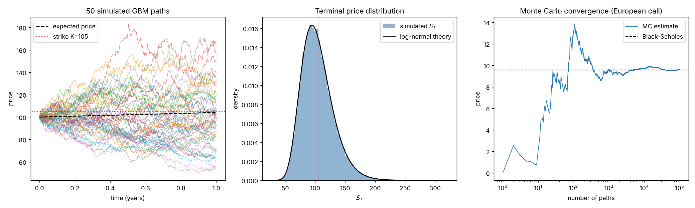

# SDE Analysis

Simulates stock prices with **geometric Brownian motion** (GBM) and prices options by **Monte Carlo**, checking the results against the closed-form **Black–Scholes** formula.

## The model

Under the risk-neutral measure the stock follows the stochastic differential equation

```
dS = r S dt + σ S dW
```

which has the exact solution

```
S(t+Δt) = S(t) · exp((r − σ²/2) Δt + σ √Δt · Z),   Z ~ N(0,1)
```

The script simulates paths both with this exact solution and with the Euler–Maruyama discretization (`S + rSΔt + σS√Δt·Z`) for comparison.

## What it does

1. Simulates 100,000 one-year daily price paths.
2. Prices a European call and put by Monte Carlo and compares them with Black–Scholes, and checks put–call parity.
3. Prices an arithmetic-average **Asian call**, a path-dependent option with no simple closed form (where Monte Carlo is genuinely needed).
4. Saves a figure: sample paths, the terminal price distribution against log-normal theory, and Monte Carlo convergence.



## Run it

```bash
pip install -r requirements.txt
python gbm_option_pricing.py
```

Change the inputs from the command line:

```bash
python gbm_option_pricing.py --S0 150 --K 160 --sigma 0.3 --T 0.5 --paths 200000
```

| flag | meaning | default |
|---|---|---|
| `--S0` | initial stock price | 100 |
| `--K` | strike | 105 |
| `--r` | risk-free rate | 0.04 |
| `--sigma` | annual volatility | 0.25 |
| `--T` | maturity (years) | 1.0 |
| `--steps` | time steps per path | 252 |
| `--paths` | number of paths | 100,000 |
| `--seed` | random seed | 42 |

## Sample output

```
Option                         Monte Carlo  ± 1 s.e.   Black-Scholes
--------------------------------------------------------------------
European call (exact GBM)           9.5946    0.0533          9.5563
European call (Euler)               9.4850    0.1182          9.5563
European put  (exact GBM)          10.4257    0.0409         10.4391
Asian call (arith. avg)             4.4818    0.0264             n/a
```

## Ideas for extending it

- Variance reduction (antithetic variates, control variates using the Black–Scholes price)
- Stochastic volatility (Heston model)
- Jump-diffusion (Merton) for fat tails
- Calibrate σ to historical returns of a real ticker

*Educational code — not investment advice.*
